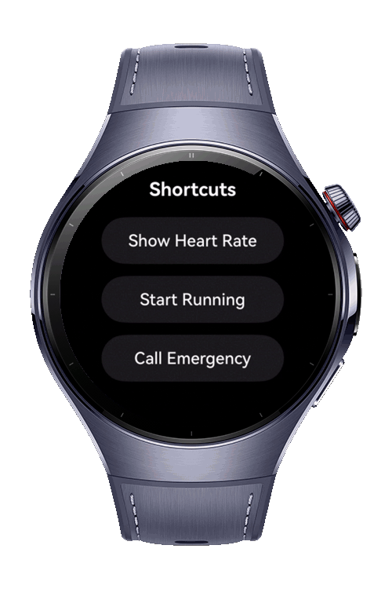
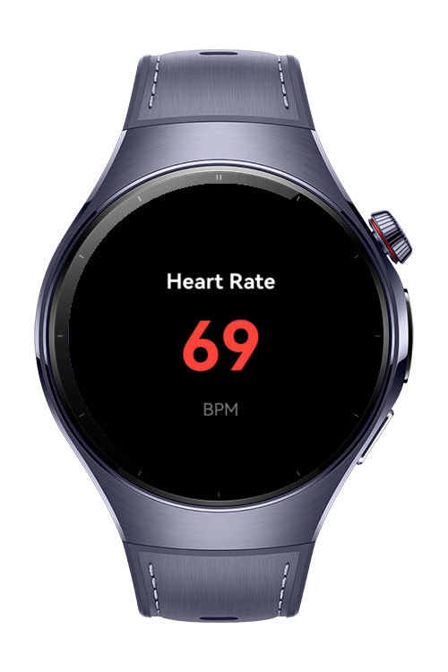
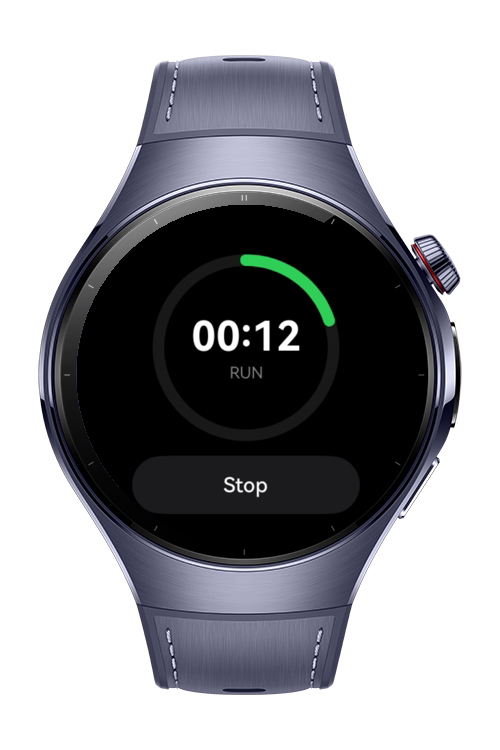
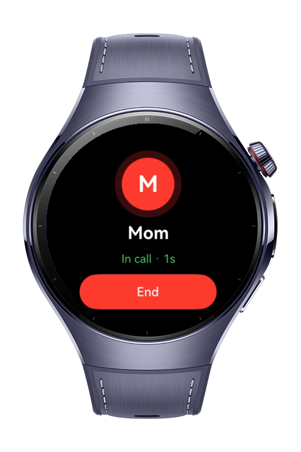

> **Note:** To access all shared projects, get information about environment setup, and view other guides, please visit [Explore-In-HMOS-Wearable Index](https://github.com/Explore-In-HMOS-Wearable/hmos-index).

# How to Build Insight Intent

A HarmonyOS NEXT application for smartwatches that demonstrates a voice-triggerable shortcut system built entirely on InsightIntent. Built with ArkTS and ArkUI, it maps three watch shortcuts to five InsightIntent mechanisms so users can say "show heart rate" to open the health dashboard, "start running" to launch the workout tracker, and "call emergency" to open the preset-contact call screen, each routed through Entry, Function, Function Method, Link, and Page intents all designed for the round watch screen.

# Preview

<div>
  
  
  
  
</div>

# Use Cases

- Open the heart rate dashboard on voice command through an InsightIntentPage target.
- Read the current heart rate value headlessly through a typed InsightIntentFunctionMethod.
- Launch the workout tracker through an InsightIntentLink deep link.
- Open the preset emergency contact call screen through an InsightIntentEntry executor.
- Route each voice command directly to its own screen without in-app menu navigation.
- Compare all five InsightIntent mechanisms side by side in one wearable app.
- Drive each screen with live mock data (heart rate, workout timer, call progress) through an MVVM ViewModel.

# Technology

## Stack

* Languages: ArkTS, ArkUI
* Frameworks: HarmonyOS SDK 6.1.0
* Tools: DevEco Studio, Hvigor
* Libraries:
    * `@kit.AbilityKit`
        * InsightIntentEntryExecutor
        * InsightIntentEntry
        * InsightIntentFunction
        * InsightIntentFunctionMethod
        * InsightIntentLink
        * InsightIntentPage

# Directory Structure

```
entry/src/main/ets/
├─ entryability/
│  └─ EntryAbility.ets
├─ pages/
│  ├─ NavigationPage.ets
│  ├─ HomeScreen.ets
│  ├─ HeartRateDashboardPage.ets
│  ├─ WorkoutPage.ets
│  └─ EmergencyCallPage.ets
├─ intents/
│  ├─ HeartRateFunction.ets
│  ├─ StartRunningLinkIntent.ets
│  └─ EmergencyEntryIntent.ets
├─ viewmodel/
│  ├─ HeartRateViewModel.ets
│  ├─ WorkoutViewModel.ets
│  └─ EmergencyViewModel.ets
├─ services/
│  └─ NavigationService.ets
├─ common/
│  └─ WatchSpacing.ets
└─ model/
   ├─ HeartRateRepository.ets
   ├─ WorkoutRepository.ets
   └─ EmergencyContactRepository.ets
```

# Constraints and Restrictions

## Supported Devices

* Huawei Watch 5

## Limitations

* InsightIntent decorators require API version 20 or later.
* InsightIntent is Stage-model only; full-ArkTS wearable required, no Lite Wearable support.
* Mock data only; no real heart-rate sensor, workout tracking, or contacts.
* Voice/AI triggering is a scenario assumption and is not reproducible on the emulator; the home shortcuts stand in for the voice commands.
* The InsightIntentLink uri is a placeholder; a real deep-link jump requires App Linking with a verified domain.
* The emergency call is mocked; real dialing requires watch telephony capability and permission.

# License

How to Build Insight Intent is distributed under the terms of the MIT License.

See the [LICENSE](LICENSE) file for more information.